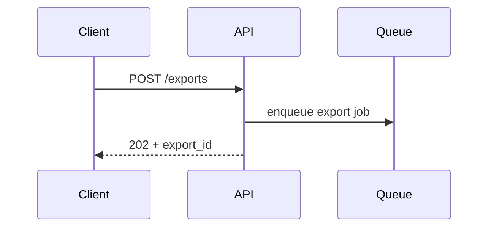

# Show me (code-shape views)

Draw the topic. Pick the smallest set of views that makes the point, usually one or two. Put one line of prose before each view saying what it shows, and nothing else. Keep only the files, calls, fields, props, and boundaries the current question needs.

Invoked directly, this skill is the user asking for diagrams, so the Plain English output style's "no diagrams unless asked" rule is satisfied. Draw from real code: open what you draw, and use real names and paths.

## Notation (every skill that draws a tree follows this)

- **Tree glyphs**: `├──`, `└──`, `│`. Never ASCII substitutes.
- **`diff` or full block**: use `diff` when the shape already exists and the point is what changes. Use a full block (language-specific or `text`) when most of it is new, or when the change only makes sense with the whole target shape visible.
- **Diff markers**: `+` opens a new entry, `-` a removed one, and a leading space opens a context or changed entry. `~` opens the clause that says what changed in a changed entry.
- **Notes**: one short clause after an entry, only where it explains ownership or behavior.
- **Size**: small enough to scan. Group files under their shared directory and leave out unchanged paths unless they give needed context.

## Views

Pick by what the point is about.

**File tree**: ownership and file boundaries.
```diff
 backend/payments/
 ├── charge.py          ~ calls settle_payment where the inline branch was
+└── settlement.py      + owns settle_payment; reaches only the gateway client
```

**Call tree**: control flow at runtime.
```diff
 handle_webhook()
-├── charge_inline()
+├── settle_payment() -> gateway.charge()
 └── ack()
```

**Component tree**: UI structure, with the state and module boundaries that matter.
```diff
 <SessionPage>              (apps/web/src/routes/session.tsx)
   useSessionEvents()
   <SessionToolbar>
+    <ResumeButton>         (packages/ui)
+      useResumeToken()
```

**Contract block**: an endpoint, message, table, or signature that other code depends on.
```diff
 POST /exports
 request
   format: "csv" | "json"
+  schedule: string | null      + cron expression; null runs once
 response
   export_id: string
```
```python
def settle_payment(charge: Charge, gateway: Gateway) -> Receipt: ...
```

**Dependency map**: coupling. Each unit, what it receives, and what that lets it do.
```text
settle_payment   receives Charge + gateway client   -> can charge; cannot read the DB
handle_webhook   receives request + settle_payment  -> can parse and ack; never reaches the gateway
```

**Mermaid flow**: interaction between components or services. Use `sequenceDiagram` for a request path and `flowchart` for components and data flow.


**Pseudocode**: an algorithm or a branching rule. Plain words, not a real language.
```text
on(save)
  if content is unchanged
    return cached result
  write new content
  return fresh result
```

## Not here

- **A screen, layout, or visible state** is a mockup, not a view. Follow `~/.claude/archive/qrspi-skills/03-design/references/artifacts.md`.
- **No HTML diagrams.** Mermaid stays in the doc as text, so reviewers and later steps can read it.
